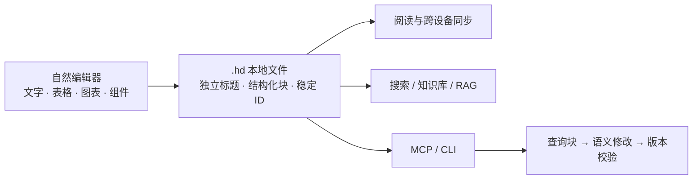
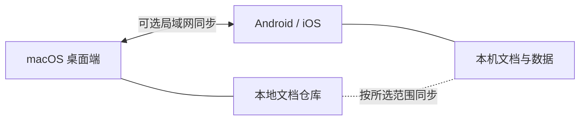

# Haven Note

**让每一个想法，都有安放之处。**

[官方网站](https://note.liuli88.com/)

Haven Note 是一款**本地优先、跨平台、面向 AI 的文档与知识工作台**。它以自研的自然编辑器为核心，把笔记保存为你能直接管理的文件：既可以继续使用 Markdown，也可以选择原生的 **Haven Document（`.hd`）**，在一篇文档中组织文字、表格、媒体、图表和结构化组件。

**你的设备、你的仓库、你的数据。** 文档以本地文件为事实来源；需要在设备间流转时，可自行开启局域网同步并选择同步范围。日常笔记、知识库、便签、任务和密钥箱放在同一工作空间，而不要求先把文档托管到第三方云端。

## 为什么是 `.hd`：为人编辑，也为 AI 理解

`.hd` 不只是把 Markdown 换一个扩展名。它是 UTF-8 编码、结构化的 Haven Document：**标题是独立字段，正文是带类型和稳定 ID 的块树**。人可以像编辑普通文档一样排版；程序可以理解“这是标题、表格、引用还是图表”，精确找到要改的块。

| 能力 | 带来的好处 |
| --- | --- |
| **结构化内容** | 标题、段落、列表、表格和扩展块各有语义；文档既能阅读，也能被检索、索引和自动化处理。 |
| **稳定块 ID + 插件 Schema** | AI 可以按块定位内容；受支持的组件可以公开自己的可读字段和允许的操作，未知组件原样保留。 |
| **语义补丁 + 版本校验** | AI 只修改选中的标题或块；写回前核对文件版本，发现别人刚改过时拒绝覆盖。 |
| **适合 RAG 的上下文** | 可以投影出紧凑语义，并按敏感级别筛选可索引内容；不必把整份 JSON 当成一段无差别的文本。 |
| **文件优先、跨平台** | `.hd` 可直接打开、原地保存和归档；文档格式不因 Windows、macOS、Android 或 iOS 而改变。 |

`.hd` 普通文档是**明文结构化文件**，便于迁移、版本比较和自主保存；敏感密码请放进独立的加密密钥箱。需要纯文本工作流时，可以继续使用 `.md` / `.markdown`。

## 自然编辑器：把内容组织成真正的文档

Haven Editor 是自研的结构化块编辑器。输入时可以使用 Markdown 快捷规则，也能通过工具栏和插入菜单组合内容；阅读态、大纲和代码高亮与编辑态共享同一份文档结构。

| 组件类别 | 已支持的内容 |
| --- | --- |
| **基础排版** | 段落、多级标题、有序/无序/任务列表、引用、分割线、链接、行内样式、代码块与代码复制。 |
| **内容组织** | 表格（增删行列、合并/拆分单元格）、图片、文件附件、目录、折叠块、多栏布局、提示/高亮块。 |
| **结构化字段** | 状态、日期、公式，以及人物、进度、数据字段、数据记录、数据视图和数据指标等数据组件。 |
| **媒体与可视化** | 本地或网页媒体嵌入、音视频、Mermaid / PlantUML / Flowchart 文本图、可视化流程图、思维导图、draw.io 图形和白板。 |

组件可组合在同一篇文档里，扩展块的数据仍随文档保存。不同格式、平台和安装版本对个别组件的编辑入口可能有所差异。

## Markdown、图表与可视化设计

- **Markdown 兼容**：直接打开和编辑 `.md` / `.markdown`；标题、列表、代码围栏等内容可以进入文档编辑体验。习惯写源码时也可以在仓库的文本编辑入口工作。
- **文本快速成图**：在文档中使用 Mermaid、PlantUML 和 Flowchart 图块。Mermaid 图可查看、缩放和下载图像；适合把流程、时序、关系写成便于版本管理的文本。
- **可视化绘图**：draw.io 图形工作台提供丰富的形状与模板，可绘制流程图、时序图、UML、ER、泳道图、网络拓扑等数十类设计图；独立思维导图支持思维导图、逻辑图、组织结构图、树形图、时间轴、鱼骨图等布局，也有流程图和白板块。图表作为文档内容保存，可随选中的仓库文件在设备间同步。

## 从笔记到知识库，再到 AI

- **知识组织**：多知识库、全文检索、知识集合与关系图谱；按来源整理资料，在知识库中检索并进行 RAG 问答。模型、索引和外部服务的使用由你配置，相关内容是否交给模型取决于你的设置。
- **MCP 接入**：Haven Note 提供 MCP 能力，可连接 Claude Code（CC）、Codex、DSH 等支持 MCP 的 AI 客户端。用自然语言查询文档、构思提纲、生成 Mermaid 图或修改受支持的结构化块；文件写入仍受授权、Schema 校验与版本校验约束。
- **不把文档锁在聊天里**：AI 处理的是你自己的文件和知识，生成结果可以继续在编辑器里检查、修改和保存。图形内部的每一种元素并不都支持 AI 语义编辑，复杂图形可在图形工作台继续调整。

## 本地掌控与跨设备流转

- **本地优先**：普通文档直接保存在所选仓库或原路径；数据库承担草稿恢复、索引和业务数据等职责。你可以用自己的文件管理、备份和迁移方式掌控文档。
- **局域网同步**：同一网络的设备可按密码配对，选择要同步的数据与仓库。自动同步由用户主动开启，数据在设备间传输；同步帧采用加密保护。不同平台的手动同步方式有所区别。
- **多平台使用**：桌面端覆盖 macOS、Windows 与 Linux，移动端覆盖 Android 与 iOS；安装包和局域网同步能力以对应平台的当前版本为准。
- **加密仓库**：桌面端可为仓库启用加密存储，打开时解锁；这与普通明文 `.hd` 文件、局域网传输加密是不同层次的保护。
- **加密密钥箱**：保存账号、密码、API 密钥等敏感信息，支持独立密钥箱、分类与自动锁定；密钥箱数据可在授权的局域网同步范围内跨设备流转。请妥善保管主密码和恢复材料。

## 也是一个能工作的文件空间

除笔记外，Haven Note 还提供便签、任务看板、账本与账单导入。仓库浏览器可以预览图片、PDF、Office 文档和电子书等文件；文本入口可编辑 `.txt`、JSON、HTML、CSS、JavaScript、TypeScript、Python、Rust、Shell 等常见源码和配置文件，并提供语法高亮、适用格式的整理以及多行文本操作。

桌面端还可以通过 **SSH / SFTP 连接远端目录**：浏览服务器文件，打开 UTF-8 文本进行编辑，再安全写回原位置。远端非文本文件、移动端 SSH 和个别本地预览格式有各自边界，详情以当前安装版本为准。

> 功能随版本迭代；下方列出的是当前公开安装包。iOS 版本正在测试，尚未公开提供 alpha.6 安装包。

## 下载

当前提供 **0.1.1-alpha.6 预发布测试版**。Android、macOS 和 Windows 安装包可从下表的 GitHub Release 附件或[官网下载区](https://note.liuli88.com/#download)下载。

| 平台 | 安装包 | 版本 | 下载 |
| --- | --- | --- | --- |
| macOS · Apple Silicon（M 系列） | 已签名并通过 Apple 公证的 arm64 DMG | 0.1.1-alpha.6 | [下载 DMG](https://github.com/GlazeChou/haven-note/releases/download/v0.1.1-alpha.6-local/Haven-Note_0.1.1-alpha.6_macOS-arm64.dmg) |
| macOS · Intel | 已签名、未公证的 Intel DMG | 0.1.1-alpha.6 | [下载 DMG](https://github.com/GlazeChou/haven-note/releases/download/v0.1.1-alpha.6-local/Haven-Note_0.1.1-alpha.6_macOS-intel.dmg) |
| Windows · x64 | 未签名的安装程序 EXE | 0.1.1-alpha.6 | [下载 EXE](https://github.com/GlazeChou/haven-note/releases/download/v0.1.1-alpha.6-local/Haven-Note_0.1.1-alpha.6_Windows-x64-setup.exe) |
| Android | 已签名的发布 APK（versionCode 12） | 0.1.1-alpha.6 | [下载 APK](https://github.com/GlazeChou/haven-note/releases/download/v0.1.1-alpha.6-local/Haven-Note_0.1.1-alpha.6_Android.apk) |
| Linux · ARM64 | Debian/Ubuntu DEB | 0.1.1-alpha.3 | [下载旧版 DEB](https://github.com/GlazeChou/haven-note/releases/download/v0.1.1-alpha.3-local/Haven-Note-Local-0.1.1-alpha.3-Linux-arm64.deb) |

iOS 的 alpha.6 尚未公开发布。Linux x64 安装包也尚未发布；Linux ARM64 仍提供 alpha.3。macOS Intel 包未公证，安装时可能出现系统安全提示。Windows 包未签名，构建源码版本尚未独立核实；应用内自动更新仍保留原版本，alpha.6 请手动下载安装。所有 alpha 版本均处于测试阶段，升级前请备份重要数据。

查看 [alpha.6 发布说明与制品](https://github.com/GlazeChou/haven-note/releases/tag/v0.1.1-alpha.6-local)。历史版本：[alpha.3](https://github.com/GlazeChou/haven-note/releases/tag/v0.1.1-alpha.3-local)、[alpha.2](https://github.com/GlazeChou/haven-note/releases/tag/v0.1.1-alpha.2-local)、[alpha.1](https://github.com/GlazeChou/haven-note/releases/tag/v0.1.1-alpha.1-local)。GitHub 自动生成的源码压缩包是源码快照，不是安装包。

## 反馈与建议

欢迎通过 [GitHub Issues](https://github.com/GlazeChou/haven-note/issues) 报告问题或提出建议。提交前请先搜索已有反馈，避免重复；写明使用的平台、应用版本、重现步骤和预期结果。截图或日志可以帮助定位问题。

**请勿在公开 Issue 中提交密码、密钥、个人笔记、账单、数据库或其他敏感信息。**

## 加入交流群

点击二维码可查看大图。QQ 扫码加入“灵栖笔记交流群”；微信扫码添加好友时，请备注 **灵栖笔记**。

| QQ 群 | 微信好友 |
| --- | --- |
| 群号：**179664248**  | 添加微信好友请备注 **灵栖笔记**。  |

## 数据说明

Haven Note 以本地优先方式工作：直接打开的 `.hd` 和 Markdown 文件保存在原位置。同步能力以所安装的测试版本和应用内设置为准。测试阶段请为重要数据自行保留备份，尤其不要把密码本作为唯一副本。

---

本仓库用于发布 Haven Note 安装包、更新说明，以及收集用户反馈。
